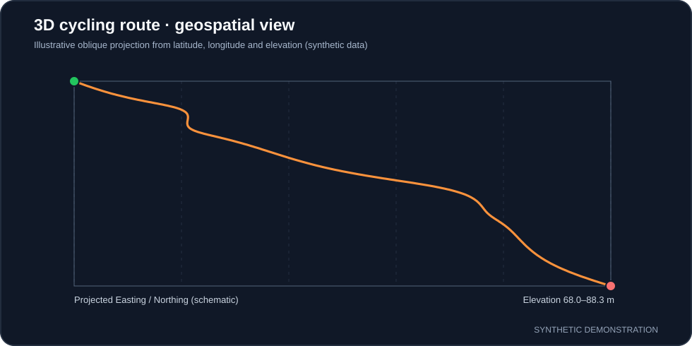
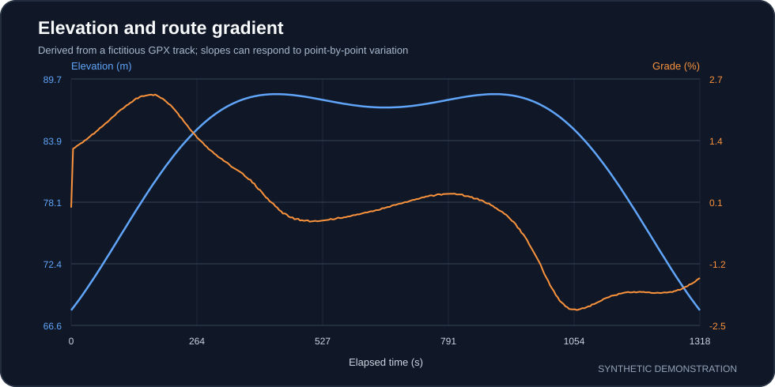
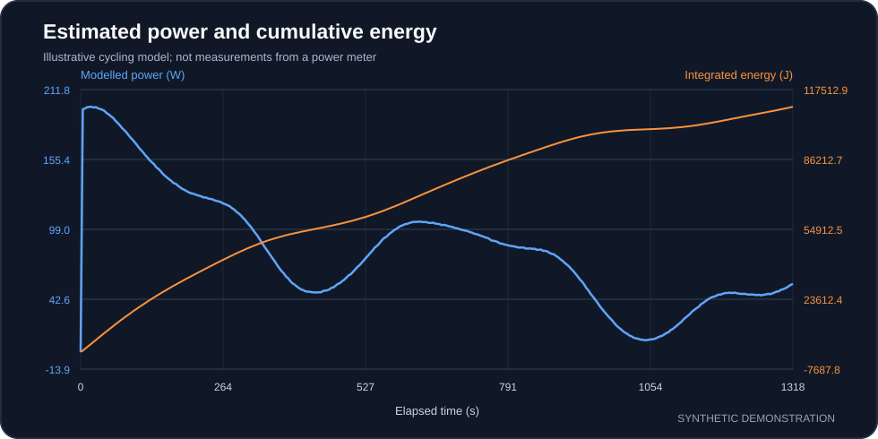

# GPS-Based Cycling Performance Analysis Using MATLAB

**An individual, post-course educational demonstration inspired by an ENGG100 (Engineering Computing and Analysis) group project at the University of Wollongong, 2026.**

> **Disclosure:** This repository is **not** our assessed group source code. It is a separately written portfolio demonstration with entirely **synthetic GPS data**, prepared after the group activity. The original university assignment and graphs were a collaboration; credit belongs to the group. The demo was prepared with AI assistance and should be verified in MATLAB before publication.

## Project overview

The original ENGG100 team project explored how raw Strava cycling activity recordings could be transformed into usable engineering insights. Three sequential milestones moved from file handling to geospatial conversion and kinematics, and finally to simplified dynamics modelling and cumulative energy estimation.

This public demonstration recreates that **type of workflow independently**, using a fictitious route so it does not disclose cyclists' locations, times, or the team's original source code.

## The three engineering stages

| Stage | Technical goal | Skills demonstrated |
| --- | --- | --- |
| 1 — GPX input | Parse timestamps, latitude, longitude and elevation using low-level file reading | File I/O, validation, structured data |
| 2 — Kinematics | Convert WGS84 coordinates to UTM Easting/Northing and compute distance, speed and grade | Geospatial systems, numerical calculations, plotting |
| 3 — Dynamics | Estimate resistance forces, cycling power and cumulative energy | Engineering mechanics, model assumptions, trapezoidal integration |

## Example visualisations

These figures are **SVG previews generated directly from the included synthetic GPX data** for documentation (not MATLAB screenshots). They are **not the original ENGG100 assessment results**. Running the MATLAB script exports its own set of six figures.







## Contents

```text
.
├── run_cycling_demo.m         # Self-contained MATLAB analysis example
├── data/
│   └── synthetic_ride.gpx    # Fictitious GPX points only
├── results/
│   ├── synthetic_3d_route.svg
│   ├── synthetic_elevation_grade.svg
│   ├── synthetic_power_energy.svg
│   └── README.md
└── docs/
    ├── CREDITS_AND_AI_USE.md
    ├── METHODOLOGY.md
    ├── LIMITATIONS.md
    ├── GITHUB_UPLOAD_GUIDE.md
    └── PUBLISHING_CHECKLIST.md
```

## How to run it

1. Download or clone the repository.
2. Open the repository folder in **MATLAB R2020a or later**.
3. Run `run_cycling_demo.m`.
4. Inspect the six MATLAB figures saved in `results/`, plus the printed distance/energy estimates.

The main script uses MATLAB's built-in functions and is intended not to require specialist toolboxes. **MATLAB execution has not been tested in this environment**; the geospatial mathematics and preview results have been checked using Python independently.

The example parser expects conventional GPX track-point tags with latitude, longitude, elevation and UTC timestamps. It is not a full XML parser, and other GPX exporters may format data differently.

## Civil engineering relevance

While this is a cycling-data project rather than a civil design task, the same foundations occur in **surveying and coordinate reference systems**, **transport alignment and route analysis**, **terrain-grade assessment**, and **numerical evaluation of engineering models**.

## Important limitations

- **Estimated power** is not measured cycling power. This basic model includes gravity along the slope, rolling resistance, aerodynamic drag and drivetrain losses, but excludes acceleration/inertial power, wind variability and many rider/bicycle effects.
- GPS noise and steep grade fluctuations can distort point-by-point speed and power estimates; raw differences should not automatically be treated as precise physical measurements.
- The code assumes each ride remains inside one UTM zone and that GPX timestamps are strictly increasing.
- Figures are for education and illustration, **not engineering design or safety decisions**.
- The original group code, course brief, and raw personal Strava GPX files are **intentionally excluded**.

See [Methodology](docs/METHODOLOGY.md), [Limitations](docs/LIMITATIONS.md), [Credits and AI Use](docs/CREDITS_AND_AI_USE.md) and the [Publishing Checklist](docs/PUBLISHING_CHECKLIST.md).

## Acknowledgement

This demonstration is inspired by collaborative work for the **ENGG100 Major Project (2026)** at UOW. The original milestone deliverables were developed by a student team, and should not be attributed to one person. The code in *this* repository is an independent reconstruction with AI assistance, not a claim to sole authorship of the original submission. Teammates can be credited by name once they are comfortable with that attribution.

## Licensing and reuse

**No open-source licence is granted by default.** A licence can be selected later for the independently written demo once its publication rights and course policy have been confirmed. Do not add the original group submission, UOW teaching materials, or real GPX recordings without appropriate permissions.
